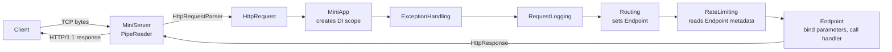

# MiniNet

**An ASP.NET Core-style web framework built from scratch in C#, on raw TCP sockets.**

MiniNet re-implements the core of ASP.NET Core without using any of it: an HTTP/1.1 server, the
middleware pipeline, routing, a dependency injection container, endpoint parameter binding, and
built-in middleware. A sample clinic-booking API runs on top of it and deploys to Azure Container
Apps with Azure SQL.

The goal is understanding, not replacing ASP.NET Core: every part is small enough to read in one
sitting, and the tests and benchmarks show how each one behaves.

```csharp
var builder = MiniApp.CreateBuilder(args);
builder.Services.AddScoped<IAppointmentService, AppointmentService>();

var app = builder.Build();
app.UseExceptionHandling();
app.UseRequestLogging();
app.UseRouting();
app.UseRateLimiting(o => { o.Capacity = 60; o.TokensPerSecond = 5; });

app.MapGet("/doctors/{id:int}", async (int id, IAppointmentService service) =>
    await service.FindDoctorAsync(id) is { } doctor ? Results.Ok(doctor) : Results.NotFound());

await app.RunAsync();
```

It looks like ASP.NET Core, but every line above runs on code in [`src/MiniNet`](src/MiniNet).
The only libraries used are the ones built into .NET itself (`System.Net.Sockets`, `System.IO.Pipelines`,
`System.Text.Json`).

## What's inside

| Part | What it does | Code |
|---|---|---|
| HTTP server | Accepts TCP connections, parses HTTP/1.1 with `PipeReader`, keep-alive, pipelining, size limits, timeouts, graceful shutdown | [`Server/`](src/MiniNet/Server) |
| Middleware pipeline | `Use`, `Run`, `Map`, `UseWhen`, class-based middleware with per-request DI | [`Pipeline/`](src/MiniNet/Pipeline) |
| Routing | Templates with constraints, optional and catch-all parameters; matched with a segment tree; 404 vs 405 | [`Routing/`](src/MiniNet/Routing) |
| Dependency injection | Singleton, scoped and transient lifetimes; circular and captive dependency detection; open generics; reflection and compiled modes | [`DependencyInjection/`](src/MiniNet/DependencyInjection) |
| Endpoint binding | Turns `(int id, Order body, IService svc) => ...` into a request handler; validation; typed results | [`Endpoints/`](src/MiniNet/Endpoints) |
| Built-in middleware | Exception handling, request logging, token-bucket rate limiting, static files | [`Middleware/`](src/MiniNet/Middleware) |
| Hosting | `MiniApp`: builder, per-request scopes, Ctrl+C and SIGTERM handling, in-process `SendAsync` for tests | [`Hosting/`](src/MiniNet/Hosting) |

## How a request flows



1. **Server.** `MiniServer` reads bytes with a `PipeReader`. TCP does not preserve message boundaries:
   one request can arrive across many reads, and one read can contain several requests. The parser
   works on a `ReadOnlySequence<byte>` and returns *Incomplete* until a whole request is buffered, so
   it never assumes a line or header is in one piece. A test feeds a request split at every possible
   byte position to prove it.
2. **Scope.** `MiniApp` creates a DI scope for the request and wraps everything in an `HttpContext`.
3. **Pipeline.** Each middleware receives the context and a `next` delegate. It can run code before
   and after `next`, or not call `next` at all to end the request.
4. **Routing.** `UseRouting` finds the endpoint and stores it on the context *without running it*,
   so middleware placed after routing (rate limiting, authorization) can read its metadata.
5. **Endpoint.** The endpoint's delegate binds parameters, calls the handler, and writes the result.
6. **Response.** The buffered response goes back to the server, which writes it with an exact
   `Content-Length`, then either waits for the next request on the same connection or closes it.

## Design notes

### Why the pipeline is built backwards
A middleware is a function from "the rest of the pipeline" to a new request handler:
`Func<RequestDelegate, RequestDelegate>`. To build the chain, `ApplicationBuilder.Build()` starts from
the terminal 404 handler and wraps it with the *last* middleware, then the one before that, and so
on. The first middleware registered ends up as the outermost layer, so it sees the request first and
the response last. ([`ApplicationBuilder.cs`](src/MiniNet/Pipeline/ApplicationBuilder.cs))

### Middleware order
The sample app uses this order, and each position matters:

1. **Exception handling first**, so it can catch exceptions from everything after it.
2. **Request logging** next, so it measures the full time, including errors.
3. **Routing** before anything that needs to know the endpoint.
4. **Rate limiting** after routing, because endpoints can opt out (the `/health` check does).
5. **Endpoints** last.

### Routing with a segment tree
Checking routes one by one costs time proportional to the number of routes. MiniNet stores routes in
a tree where each level is one path segment, so matching depends on the number of segments in the
path instead. At each level it tries the most specific option first (literal, then constrained
parameter, then plain parameter, then catch-all) and backtracks if that branch fails further down.
Two templates that would match the same requests, such as `/users/{id}` and `/users/{name}`, are
rejected at startup rather than surprising someone in production. ([`Router.cs`](src/MiniNet/Routing/Router.cs))

### The DI container
Each registration is turned into a *call site*: a recipe saying which constructor to call and the
recipes for its arguments. Call sites are built and validated once, then either walked with reflection
or compiled into a delegate with expression trees.

Validation catches three classic mistakes when the app starts:
- **Missing dependency**: `Unable to resolve service for type 'IClock' while attempting to activate 'Repository'`.
- **Circular dependency**: `Circular dependency detected: CycleA -> CycleB -> CycleC -> CycleA`.
- **Captive dependency**: a singleton that depends on a scoped service would keep one request's
  instance (say, a database context) forever and share it across threads. MiniNet rejects this, including
  when the scoped service is hidden behind a transient.

Singletons are always created by the root scope, so a singleton that asks for `IServiceProvider` gets
the root provider and never captures a request scope. Scopes dispose their services newest first, so a
service is disposed before the dependencies it was built from.

### Parameter binding
Where a handler parameter comes from is decided once, when the endpoint is mapped:

1. An explicit `[FromRoute]`, `[FromQuery]`, `[FromHeader]`, `[FromBody]` or `[FromServices]` attribute.
2. `HttpContext`, `HttpRequest`, `HttpResponse` and `CancellationToken` are supplied directly.
3. A name that matches a route parameter binds from the route.
4. A simple type (number, string, date, `Guid`, enum) binds from the query string.
5. A type registered in DI comes from the request scope.
6. Anything else is deserialized from the JSON body (at most one parameter).

Mistakes like two body parameters, or an interface that isn't registered, fail at startup. Bad input
from clients becomes a `400` problem response listing every invalid field, and data annotations such
as `[Required]` and `[Range]` on the body are validated. The handler call itself is compiled into a
strongly typed delegate, so no reflection runs per request.

### Graceful shutdown
On Ctrl+C or SIGTERM (what Docker and Azure send), the server stops accepting connections and closes
idle keep-alive connections at once, but requests already being handled run to completion. Only
requests still running after `ShutdownTimeout` are aborted.

## Running it

Requires the [.NET 10 SDK](https://dotnet.microsoft.com/download).

```bash
dotnet test                                   # 139 tests: framework + sample app
dotnet run --project samples/AppointmentsApi  # http://localhost:8080
```

Try the sample API:

```bash
curl localhost:8080/doctors?specialty=cardiology
curl "localhost:8080/doctors/1/slots?date=2026-12-01"
curl -i -X POST localhost:8080/doctors/1/appointments \
     -H "Content-Type: application/json" \
     -d '{"patientName":"Elene","startsAt":"2026-12-01T10:30:00+04:00"}'
curl -i -X PUT localhost:8080/doctors/1        # 405 Method Not Allowed, Allow: GET, HEAD
```

Without configuration the sample uses in-memory storage. Set `APPOINTMENTS_CONNECTION_STRING` to an
Azure SQL or SQL Server connection string to use the database; the schema in
[`infra/sql/schema.sql`](infra/sql/schema.sql) is applied automatically on startup.

### The sample: AppointmentsApi
A clinic booking API for the Georgian time zone (UTC+4, no daylight saving): doctors, free 30-minute
slots, booking and cancelling. The interesting part is **double-booking prevention**. Checking "is the
slot free?" and then inserting would let two simultaneous requests both see the slot as free. Instead:

- In SQL, the insert and the check are one statement with `UPDLOCK, HOLDLOCK`, backed by a unique
  index on `(DoctorId, StartsAt)` as the final guarantee.
- In memory, a lock makes the check and the insert one step.

A test fires 50 simultaneous bookings for the same slot and asserts that exactly one succeeds.

## Benchmarks

```bash
dotnet run -c Release --project benchmarks/MiniNet.Benchmarks -- --filter '*'
```

| Benchmark | Compares |
|---|---|
| `ParserBenchmarks` | Parsing a GET, a POST with a JSON body, and a GET split into 16-byte segments |
| `RouterBenchmarks` | Segment tree vs. checking routes one by one, with 10, 100 and 500 routes |
| `DependencyInjectionBenchmarks` | Reflection vs. compiled expression trees, for one resolve and for a full request scope |
| `PipelineBenchmarks` | A full request through the framework without the socket |

**Load test against ASP.NET Core.** [`benchmarks/LoadTest`](benchmarks/LoadTest) has two tiny apps
with identical endpoints, one on MiniNet and one on Kestrel, and a [k6](https://grafana.com/docs/k6/latest/)
script. `benchmarks/LoadTest/run.sh` builds both and runs the same load against each. Run the load
tool on a different machine from the server if you can: on a small machine the load tool competes with
the server for CPU, and the numbers mostly measure the load tool.

<!-- Fill in after running on your machine: -->
| | MiniNet | ASP.NET Core (Kestrel) |
|---|---|---|
| Requests/sec | | |
| p95 latency | | |

## Deploying to Azure

[`infra/main.bicep`](infra/main.bicep) creates a Log Analytics workspace, a Container Apps environment,
the Container App (scale to zero, HTTPS terminated by Azure), and a serverless Azure SQL database that
pauses when idle. [`.github/workflows/deploy.yml`](.github/workflows/deploy.yml) builds the Docker image,
pushes it to GitHub Container Registry, and deploys the Bicep template.

One-time setup:

1. Create a resource group: `az group create -n mininet-rg -l westeurope`.
2. Create an app registration for GitHub Actions with a federated credential for this repository,
   and give it the *Contributor* role on the resource group
   ([guide](https://learn.microsoft.com/azure/developer/github/connect-from-azure-openid-connect)).
   No Azure password is stored in GitHub.
3. In the repository settings, add:
   - Secrets: `AZURE_CLIENT_ID`, `AZURE_TENANT_ID`, `AZURE_SUBSCRIPTION_ID`, `SQL_ADMIN_PASSWORD`.
   - Variable: `AZURE_RESOURCE_GROUP` = `mininet-rg`.
   - Either make the `mininet-appointments` package public after the first push, or add a
     `GHCR_PULL_TOKEN` secret (a GitHub token with `read:packages`) so Azure can pull the private image.
4. Run **Deploy to Azure** from the Actions tab. The job summary shows the app's URL.

## Limitations

These are deliberate, to keep the code readable:

- **HTTP/1.1 only.** No HTTP/2 or HTTP/3, and no TLS; in Azure, HTTPS ends at the Container Apps ingress.
- **No chunked request bodies.** Requests must send `Content-Length`; chunked bodies get `501`.
- **Buffered responses.** Responses are built in memory and sent at once, which keeps framing simple
  but is not suited to very large downloads or streaming.
- **The parser favours clarity over speed.** It creates strings for the request line and headers.
  Kestrel parses directly from byte spans with almost no allocations; that is the first thing to change
  for performance.
- **SQL authentication.** The Azure deployment uses a SQL login stored as a Container Apps secret. The
  more secure next step is a managed identity, so no password exists at all.

## How AI was used

<!--
Write this section yourself, honestly. Interviewers value it. For example:
- which parts you designed yourself and which you generated with an AI tool,
- where the AI got something wrong and how you found out (a failing test, a code review),
- what you changed or rewrote, and what you learned from reviewing it.
-->
